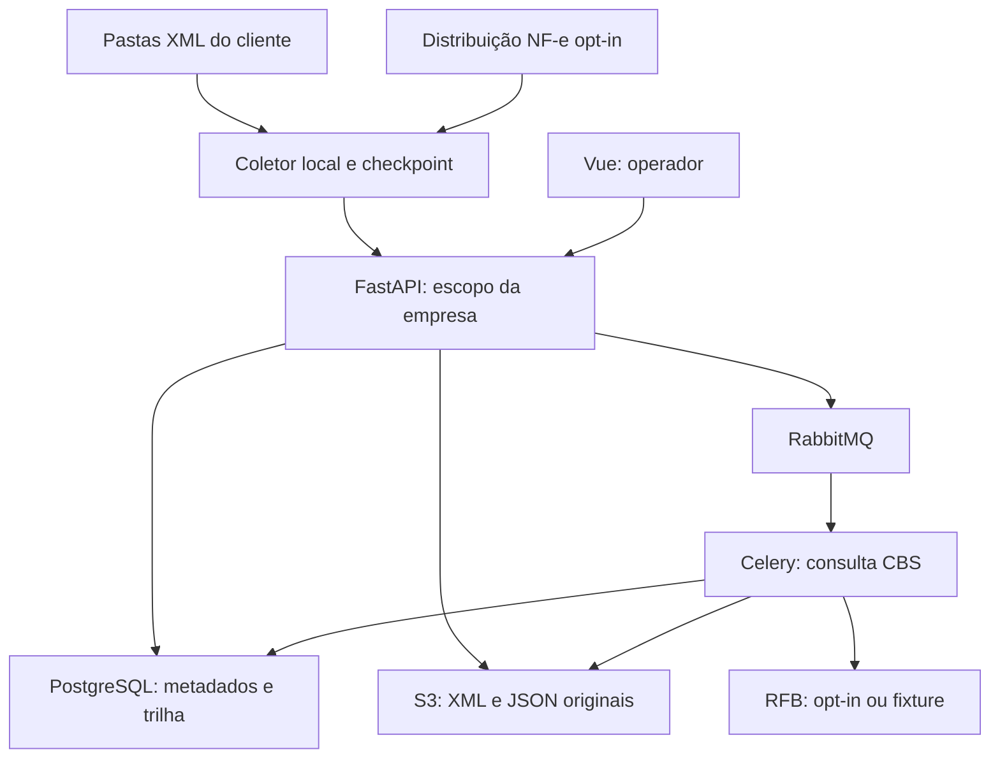
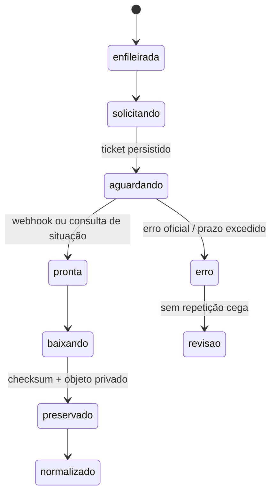

# Arquitetura — plataforma de evidências e conferência fiscal

**Estado em 14/10/2026:** a base CBS foi ampliada com ingestão XML, coletor local de pastas, comparação por competência, controles manuais e agenda CBS opcional. O código e os testes locais de cada frente não constituem implantação Docker/Windows, publicação GHCR ou homologação autenticada com Receita, CGIBS ou SEFAZ. Os parágrafos marcados como **meta** descrevem trabalho posterior.

## Objetivo e limites

Uma plataforma independente reúne consultas CBS, XMLs de fontes autorizadas, controles informados pelo cliente e trilha de evidências em uma organização e empresa definidas. A comparação assistida expõe valores e divergências para revisão humana, sem declarar imposto, apropriar crédito, concluir cobertura oficial nem inferir que pagamento comercial extinguiu débito tributário. CBS, IBS e famílias DF-e preservam contratos, autorizações e estados separados.

**Stack escolhida:** FastAPI/Pydantic, SQLAlchemy 2/Alembic, PostgreSQL, RabbitMQ/Celery, Redis, armazenamento pela API S3 genérica (RustFS local no Compose ou S3 externo), Vue 3/TypeScript/Vite, Docker Compose e imagens GHCR. O deployer Windows usa núcleo Python comum à CLI e GUI Tkinter, empacotado com PyInstaller. O backend seleciona endpoint, região, bucket e credenciais por configuração `S3_*`, sem acoplar a persistência a um produto de armazenamento.

### Estado das frentes

Esta tabela diferencia código/testes locais da validação operacional ainda pendente:

| Área | Estado observado | Ainda não comprovado/concluído |
| --- | --- | --- |
| API CBS e modelo | FastAPI/SQLAlchemy, fixture, cliente Receita opt-in, ticket/webhook/status, armazenamento de JSON bruto e observações; agenda opt-in para recursos configurados. | Consulta autenticada de contribuinte autorizado, aderência integral aos arquivos oficiais, migrations em PostgreSQL de produção e cobertura incremental comprovada. |
| XML e agente | Token limitado à empresa; ingestão de XML original até 10 MiB, SHA-256, deduplicação e extração limitada; coletor de pastas com SQLite/retry, systemd/WinSW e workflow de binários. | Testar instalação/binários em hosts reais, validação XMLDSig/cadeia/schema/autorização, operação em volume e backup/restore de arquivo e banco. |
| SEFAZ NF-e opcional | Adaptador local `distNSU` com SOAP 1.2/mTLS, PEM separado, spool durável e checkpoint NSU; guarda SOAP, gzip e XML, classifica resumos/eventos e envia apenas XMLs integrais elegíveis. | Credencial/ator, WSDL/XSD corrente, homologação autenticada, coordenação NSU com outros consumidores e confirmação de origem/assinatura/autorização. |
| Conferência e crédito | Cruzamento somente leitura por empresa/competência, diferença de valores, ambiguidade e ausência local; cadastro manual de parcela comercial e candidato a crédito de estoque em rascunho. | Prova de cobertura oficial, revisão da regra fiscal, conciliação ERP ampla e motor legal de crédito presumido. |
| Fila e armazenamento | Celery/RabbitMQ, Redis, boto3 e RustFS local no Compose; objetos brutos com hash. | Outbox transacional, retenção/versionamento, restauração testada, contrato S3 sob carga e falhas do broker. |
| Identidade | Organização, usuário, papéis básicos e agente com hash de token, revogação e escopo de empresa. | MFA, cofre/cifragem por organização, RLS, credenciais governamentais por tenant. |
| UI, CI e deployer | Vue e testes locais; templates Compose validados estaticamente, CLI/Tkinter e scripts CI de release. | Workflow executado no GitHub, Compose real, binários Linux/Windows validados em destino, GHCR e release publicados. |
| IBS e SEFAZ | Contratos oficiais mapeados; fronteira CBS/IBS definida. Distribuição NF-e exige adaptador separado do coletor de pasta. | IBS em produção e conectores DF-e com credenciais e casos autenticados individuais; CT-e/MDF-e/NFS-e não são herdados da NF-e. |

Atualizar este quadro somente com evidência de testes e execução. A primeira release técnica pode sair com capacidades menores do que a arquitetura alvo, desde que o painel mostre o estado real.

O coletor de pastas envia arquivos previamente disponíveis no cliente. O adaptador NF-e `distNSU` é uma opção **implementada localmente** no mesmo processo, mediante certificado e papel autorizado, NSU próprio e controles de consumo; enviar XML à plataforma não concede essa permissão. A leitura e a transmissão têm checkpoints distintos. O IBS requer adaptador separado: o [MOC v1.10](CONTRATOS-OFICIAIS-2026.md) documenta parte do fluxo em homologação, mas ainda traz rotas propostas e produção futura.

## Serviços e responsabilidades

| Serviço | Responsabilidade | Dados duráveis |
| --- | --- | --- |
| `api` (FastAPI) | Login, organização/empresa, consultas CBS, webhook `HEAD`/`POST`, XML/agents, comparação por competência, controles manuais, health e OpenAPI | PostgreSQL e referências de objetos; token de agente somente em hash. |
| `worker` (Celery) | Obter token CBS, abrir consulta, recuperar situação, baixar, preservar e projetar arquivo | PostgreSQL e bucket S3 configurado. |
| `scheduler` (Celery Beat) | Retomar tickets e, se `CBS_AUTO_SYNC_ENABLED=true`, enfileirar um recurso devido por CNPJ base/ambiente, limitado a quatro aberturas registradas por 24 horas e a uma solicitação ativa por base | Consultas e auditoria persistidas em PostgreSQL. Não atesta completude da janela. |
| `collector` (fora da stack, no cliente) | Monitorar diretórios e, opcionalmente, consultar NF-e `distNSU` via mTLS; esperar arquivo estável, calcular hash e enviar XML integral elegível por HTTPS | XML de pastas permanece intocado; SOAP/gzip/XML da distribuição são guardados em spool, checkpoint NSU e estado de upload separados em SQLite; segredos fora do JSON. |
| `outbox-dispatcher` (**meta**) | Publicar tarefas/eventos depois de transação confirmada e repetir publicação pendente | Tabela outbox e carimbo de entrega futuros. |
| `manager` (Vue) | Capacidades, consultas, registros, XMLs/agentes e conferência visual; senha e token novo tratados como segredo | Telas de conciliação não aprovam crédito, pagamento ou autorização de DF-e. |
| `postgres`, `rabbitmq`, `redis`, `rustfs` (somente opção local) | Estado transacional, broker, cache/coordenação e objeto privado, respectivamente; com S3 externo, nenhum serviço de objeto roda no Compose | Volumes e backup próprios para os serviços locais; política contratual de backup do S3 externo. |
| `migrate` | Aplicar Alembic antes do serviço que depende do schema | Histórico de migrations no PostgreSQL. |

**Separação lógica:** `core` (identidade/tenant), `CBS` (consulta, worker, agenda), `documents` (agente, ingestão, parser e objeto), `reconciliation` (comparação somente leitura), `finance-controls` (fatos manuais), `operations` (deployer, backup, binários). O futuro conector IBS e cada DF-e serão próprios; interfaces de adaptador não devem transportar regras ou nomenclatura de outros produtos.

## Escopos, isolamento e credenciais

- Consultas CBS usam organização, ambiente, recurso e CNPJ base. A API documentada usa a **raiz de oito posições como string**; o cadastro local de CNPJ ainda valida o formato numérico. Suporte alfanumérico e acesso efetivo precisarão de verificação antes de habilitar novos CNPJs. Preservar CNPJ completo/estabelecimento para autorização, ingresso de documentos e auditoria. Fontes: [campo CBS](https://docs.receitafederal.gov.br/apuracao-cbs/debito.html) e [orientação da Receita sobre CNPJ alfanumérico](https://www.gov.br/receitafederal/pt-br/centrais-de-conteudo/publicacoes/perguntas-e-respostas/cnpj/cnpj-alfanumerico.pdf).
- Uma credencial do estabelecimento matriz pode habilitar consultas de sua base conforme o contrato oficial. A plataforma deve conferir, no cadastro e em cada job, que o CNPJ solicitado está vinculado à organização autorizada, com segregação de ambientes e capacidade.
- O cliente CBS usa OAuth2 Client Credentials com **uma configuração privada por instalação** e `CBS_CREDENTIAL_ORGANIZATION_ID`/`CBS_ALLOWED_BASES`; não há cofre nem segregação de credenciais por tenant. `PROVIDER_MODE=fixture` e flags oficiais desabilitadas são padrões seguros. Configuração de ambiente não equivale a credencial cifrada por organização.
- Um administrador da organização emite e revoga o token de agente; somente o hash é guardado no banco. O token só ingere XML para `company_id` atribuído. Listagem/download exigem sessão de usuário na mesma organização; verificar acesso em cada recurso. **Metas de acesso:** MFA, papéis granulares, cofre, Row Level Security e auditoria end-to-end em banco, fila, objetos e exportações.
- `Idempotency-Key` da API interna e unicidade no banco previnem duplicação na abertura e no processamento; não confundir o mesmo ticket reapresentado com nova consulta governamental.

## Fluxo CBS assíncrono

A [regra oficial das APIs assíncronas](https://docs.receitafederal.gov.br/apuracao-cbs/guiaapiassincrona.html) descreve OAuth2 Client Credentials, validação `HEAD` da `urlRetorno`, retorno HTTP 201 com `tiqueteSolicitacao`, notificação posterior ou consulta de situação, URL de download temporária, prazo esperado de processamento até 240 minutos, disponibilidade do arquivo por 48 horas e limite de quatro aberturas por dia. Configurar quotas e timers por recurso, CNPJ base e ambiente segundo o contrato vigente, em vez de hardcode global.

1. Um pedido explícito ou a agenda opt-in cria a `Query` com recurso, ambiente, organização, CNPJ base e chave de idempotência. A agenda é desabilitada por padrão, exige provedor Receita e flags do ambiente, limita aberturas registradas a quatro por base/24 horas, seleciona recursos devidos e deixa estados incertos para revisão. Ela não confirma que todos os documentos do mês foram retornados.
2. No provedor real, o worker usa a credencial configurada, abre a consulta, persiste ticket, aceita webhook e consulta situação se necessário. `HEAD` valida a disponibilidade do callback. O link de download assinado não é disponibilizado à UI; o arquivo recebido é preservado com SHA-256 e a projeção guarda origem dos registros.
3. O endpoint do webhook lida com repetição; correspondência de ticket e escopo é obrigatória. A documentação oficial recomenda proteção contra repetição, mas **não autoriza presumir uma assinatura HMAC fornecida pelo governo**. Verificar HTTPS público e comportamento real do contrato antes de habilitar o provedor.
4. **Metas de robustez:** outbox transacional, histórico de cada observação oficial e projeção corrente versionada, alertas de lacuna incremental, auditoria da entrega de callback, recuperação após falha de broker e política de dead-letter. Uma consulta ou normalização concluída não executa automaticamente a comparação de todos os XMLs; o endpoint de conciliação é somente leitura e sob demanda.

Consultas de créditos da CBS têm, na versão oficial analisada, janela de retorno máxima de oito dias; a primeira consulta sem histórico retorna inclusões/alterações desde o primeiro dia do mês corrente. **Não prometer recuperação automática de períodos mais antigos por simples repetição.** Programar consulta regular, persistir sucesso e lacunas, alertar quando o intervalo sem cobertura se aproximar do limite e definir procedimento oficial para reconstrução. Ver [contrato oficial de créditos](https://docs.receitafederal.gov.br/apuracao-cbs/credito.html).

## Créditos e conciliação fiscal

O retorno de crédito CBS preserva campos **a apropriar**, **apropriado** e **utilizado** sem derivar direitos a partir de XML. O cadastro manual `StockCreditClaim` é apenas um candidato em rascunho, independente de `Record`. `CommercialInstallment` representa observação de contas a pagar, sem baixa tributária. Futuras regras de estoque de abertura precisam de base legal, versão, inventário, revisão fiscal e ledger próprios.

| Fato ou evento | Origem | Tratamento |
| --- | --- | --- |
| NF-e/NFC-e, CT-e, MDF-e e eventos recebidos | XML original no cliente ou outra origem autorizada | Hash do original, extração limitada e indicadores declarados de assinatura/protocolo. O campo `reported_authorized` é uma **alegação do XML**, não consulta ao autorizador. |
| Pagamento de parcela comercial | Entrada manual (`CommercialInstallment`) | Fato financeiro separado; não liberar crédito nem marcar débito tributário como extinto. |
| Extinção de débito tributário/split payment | Retorno governamental autorizado e vínculo documental, **meta** | Regras próprias, datas, valores e revisão; nenhuma inferência a partir da parcela comercial. |
| Crédito CBS a apropriar/apropriado/utilizado | Observação de consulta e arquivo JSON bruto | Expor campos oficiais quando presentes, com distinção entre zero e ausente. |
| Candidato a crédito presumido de estoque | Entrada manual (`StockCreditClaim`) | `draft`, valor esperado e referência; sem cálculo, apropriação ou validação da evidência. |
| IBS | MOC CGIBS v1.10 e futura resposta autenticada | Adaptador/modelo próprios quando rotas, acesso e contrato final forem confirmados. |

A comparação implementada recebe `organization_id`, `company_id` e competência `AAAA-MM`, aceita formatos históricos do período na fonte e usa chave DF-e de 44 dígitos, tipo, direção e valores `Decimal`. Deduplica observações idênticas de consultas repetidas sem somar registros ambíguos. Estados: `match` somente para igualdade de valor CBS em documento e observação comparáveis, `mismatch`, `missing` para item oficial sem XML local, `ambiguous` e `unknown`. Sem prova explícita de cobertura oficial completa, um XML local sem registro CBS é `unknown`; o endpoint atual sempre retorna `official_coverage_proven: false`. Pagamentos oficiais e candidatos manuais não são transformados em crédito por esta comparação.

### Arquivo XML e verificação posterior

`POST /api/v1/documents/ingest` recebe bytes `application/xml` até 10 MiB, confere `X-Content-SHA256`, associa agente à empresa e usa `organization_id`, `company_id`, `sha256` para deduplicar. O parser rejeita DTD, entidades, XInclude e árvores grandes; extrai metadados, não valida XMLDSig nem esquema oficial. O CNPJ observado no XML permite rotear a empresa, sem provar propriedade. O objeto S3 conserva os bytes originais e a API devolve hash no download. Validação criptográfica, cadeia, versão do schema, confirmação na fonte oficial e prova de autorização continuam etapas independentes.

Na distribuição NF-e, o adaptador opt-in `distNSU` usa certificado e chave PEM locais, sem copiar a chave para a plataforma. Limita tamanhos SOAP, gzip e XML; escreve retorno bruto, `docZip`, XML e manifesto em spool privado antes de avançar o checkpoint NSU em SQLite. `137` e fim de sequência acionam espera superior a uma hora; `656` não avança NSU e impõe espera. Resumos `resNFe`/`resEvento` ficam `summary_unprocessed`, schema desconhecido em `schema_quarantine`, arquivos integrais com marcador XMLDSig em `ready`. Somente `ready` entra no scanner de envio. Os estados `ready` e `sent` não validam assinatura, autorização ou completude fiscal; `sent` confirma apenas ingestão da cópia. Compartilhar NSU com outro software exige coordenação operacional. Consulte [contratos e cautelas](CONTRATOS-OFICIAIS-2026.md).

## Dados, retenção e operações

Modelos concretos em `apps/api/app/models.py` incluem `Organization`, `User`, `Company`, `Query`, `Record`, `AuditEvent`, `AgentCredential`, `FiscalDocument`, `StockCreditClaim` e `CommercialInstallment`. Migrations Alembic acrescentam as tabelas sem exigir renomeação dos modelos iniciais. **Metas separadas:** credenciais governamentais segregadas, ledger fiscal, comprovação de cobertura, outbox, retenção configurável e log de reconciliação persistente. A limpeza de caches de CI/GHCR jamais deve afetar dados fiscais.

Objetos originais CBS/XML são mantidos em bucket privado e associados a checksum e metadados no banco. **Metas de persistência:** versionamento/bloqueio quando exigido por política aprovada, exportação com origem/hash/versão de parser e backup/teste de restauração do PostgreSQL **e** bucket. O backup `scripts/backup.sh` cobre apenas o banco. Versionamento S3 e restore não foram comprovados. RustFS serve à stack local; sua [matriz de compatibilidade](https://docs.rustfs.com/en/reference/s3-compatibility) não substitui teste de integração, segurança, resiliência e restauração em produção. S3 externo requer os mesmos testes. MinIO não é backend ativo; o [advisory publicado](https://github.com/minio/minio/security/advisories/GHSA-xh8f-g2qw-gcm7) motivou a decisão inicial.

`/health/live` verifica processo; `/health/ready` testa banco e Redis. **Meta operacional:** incluir broker, armazenamento e migrations na prontidão por papel; métricas de consulta pendente, ticket vencendo, cobertura incremental, retry, divergência e falha de download. Logs não devem conter XML/JSON fiscal integral, senha, token nem URL assinada. Estado governamental é uma observação externa, não uma única verdade em Redis.

## Distribuição e versionamento

`develop` gera imagens `:develop` e atualiza **uma** pré-release móvel com GUI/CLI Windows e checksums após os gates. `main` recebe promoção por PR, cria SemVer estável `vX.Y.Z`, imagens com `X.Y.Z` e digest, manifesto verificável e GitHub Release imutável após build e smoke tests. `latest` e `stable` apontam para a versão estável publicada; stacks canônicas usam digest/version pin explicitamente. Não apagar imagem de qualquer release estável/canônica retida. Limpeza atinge apenas cache/artefatos temporários identificados com inventário completo, dry-run e limites de lote. O deployer preserva `.env` e volumes existentes, gera segredos fortes apenas onde faltam, escreve de forma atômica e valida o Compose final.

## Contratos externos e estado de prontidão

O [comunicado da Receita de 14/09/2026](https://www.gov.br/receitafederal/pt-br/assuntos/noticias/2026/setembro/receita-federal-publica-nova-documentacao-tecnica-das-apis-de-apuracao-de-cbs) anuncia disponibilização gradual da CBS; o [MOC IBS v1.10](CONTRATOS-OFICIAIS-2026.md) já foi publicado, mas identifica etapa em homologação, rotas propostas e produção futura. Para cada operação manter `documentada`, `implementada localmente`, `ambiente confirmado`, `credenciais autorizadas`, `teste real aprovado` e `habilitada` como condições distintas. Nenhum endpoint IBS está ativo na aplicação. Uma fixture ou suíte unitária não muda o estado de teste oficial.
